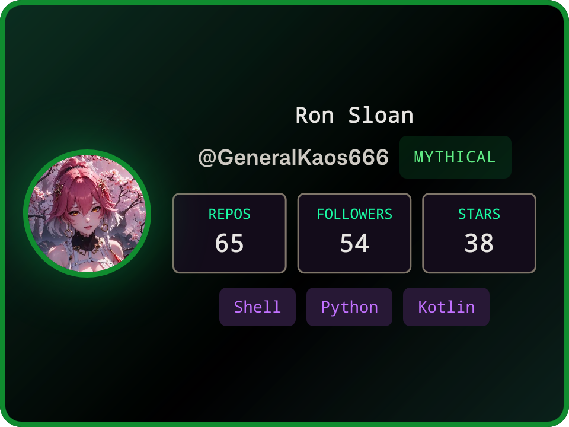
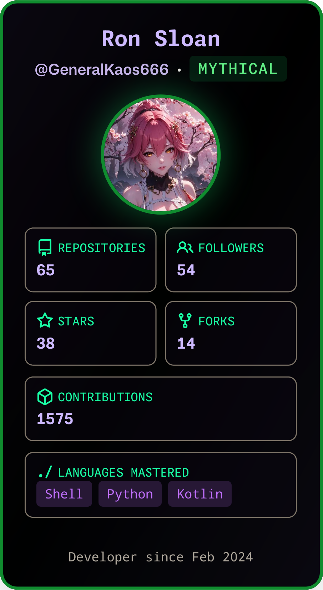

<p align="center">
  
</p>

<p align="center">
  
</p>

<p align="center">
  <a href="https://github.com/GeneralKaos666?tab=followers"></a>
  <a href="https://generalkaos666.github.io/"></a>
  
</p>

<div align="center">
  <table>
    <tr>
      <td valign="middle"></td>
      <td valign="middle"></td>
    </tr>
  </table>
</div>

> Android apps in Kotlin and Compose. KDE Plasma themes in QML. Built on Termux, no root.

---

### `01 // ABOUT`

```console
┌──(kaos㉿termux)-[~]
└─$ whoami
Ron Sloan  ·  GeneralKaos666

┌──(kaos㉿termux)-[~]
└─$ cat stack
build : Android apps · Kotlin + Jetpack Compose
theme : KDE Plasma · QML · Aero and Vista
shell : Zsh + Zinit + Termux, no root
rule  : ship it, then polish it

┌──(kaos㉿termux)-[~]
└─$ uptime
up since 2024 · 65 public repos
```

---

### `02 // TECH_STACK`

#### `// ANDROID_MOBILE`


#### `// LANGUAGES`


#### `// TOOLS_PLATFORMS`


---

### `03 // FEATURED_PROJECTS`

| # | Project | What it does | Stack | Stars |
| :-: | :--- | :--- | :---: | :---: |
| 1 | **[flutter-for-termux](https://github.com/GeneralKaos666/flutter-for-termux)** | Run Flutter on Termux, stable channel · fork of [yamsergey/yamsergey.termux.flutter](https://github.com/yamsergey/yamsergey.termux.flutter) | Shell |  |
| 2 | **[androidstudio-for-termux](https://github.com/GeneralKaos666/androidstudio-for-termux)** | Android Studio tooling that runs on-device in Termux | Shell |  |
| 3 | **[SetEditPlus](https://github.com/GeneralKaos666/SetEditPlus)** | Maintained, buildable SetEdit · fork of [kerneldroid/SetEditPlus](https://github.com/kerneldroid/SetEditPlus) | Kotlin |  |
| 4 | **[OmniRoute](https://github.com/GeneralKaos666/OmniRoute)** | Free AI gateway: one endpoint, 160+ providers, MCP and A2A · fork of [diegosouzapw/OmniRoute](https://github.com/diegosouzapw/OmniRoute) | TypeScript |  |
| 5 | **[VidSync](https://github.com/GeneralKaos666/VidSync)** | Download video from a link · fork of [itsvks19/VidSync](https://github.com/itsvks19/VidSync) | Kotlin |  |
| 6 | **[pdx-bus-tracker](https://github.com/GeneralKaos666/pdx-bus-tracker)** | TriMet arrivals for Android | Kotlin |  |
| 7 | **[ghost-rain](https://github.com/GeneralKaos666/ghost-rain)** | Matrix rain wallpaper with a system HUD | Kotlin |  |
| 8 | **[termux-adb](https://github.com/GeneralKaos666/termux-adb)** | ADB and Fastboot in Termux, no root · fork of [rianprei/termux-adb](https://github.com/rianprei/termux-adb) | Shell |  |

---

### `04 // CURRENTLY_WORKING_ON`

<!-- WORKING_ON:START -->
- **[flutter-for-termux](https://github.com/GeneralKaos666/flutter-for-termux)** : Run Flutter on Termux! (Flutter Channel Stable) · Python 
- **[flutter-for-termux-beta](https://github.com/GeneralKaos666/flutter-for-termux-beta)** : Run Flutter on Termux! (Flutter Channel Main) · Shell 
- **[termux-apt-repo](https://github.com/GeneralKaos666/termux-apt-repo)** : no description · Python 
- **[octocanvas](https://github.com/GeneralKaos666/octocanvas)** : A web app that creates GitHub-themed collectibles from GitHub profiles · TypeScript 
- **[termux-settings](https://github.com/GeneralKaos666/termux-settings)** : no description · Rust 
<!-- WORKING_ON:END -->
<sub>featured = hand-picked pins · working_on = recently touched · badges pull live</sub>

---

### `05 // STATS`

<p align="center">
  <a href="https://github.com/GeneralKaos666">
    
  </a>
  <a href="https://github.com/GeneralKaos666">
    
  </a>
</p>

<p align="center">
  
</p>

<p align="center">
  
</p>

<p align="center">
  
  
</p>

---

### `06 // CONTRIBUTIONS`

<p align="center">
  
  
</p>

<p align="center"><sub>Grid from <a href="https://github.com/Platane/snk">Platane/snk</a></sub></p>

---

<p align="center">
  
</p>

<p align="center"><sub><code>while (!done) { build(); }</code></sub></p>
